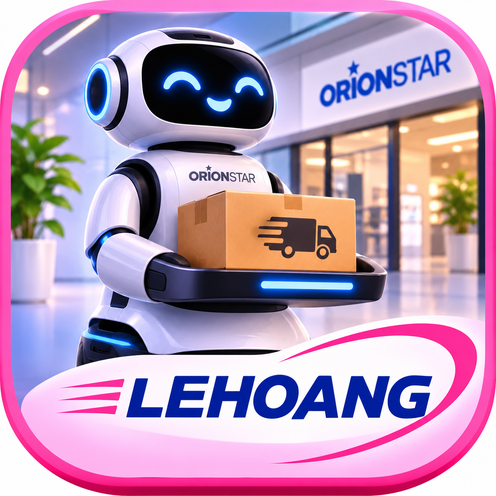

# 🤖 LÊ HOÀNG ROBOTICS - FLEET CONTROL & DELIVERY SYSTEM

Hệ sinh thái điều khiển, quản lý đội robot tự hành và giao diện điều hướng Kiosk giao hàng thông minh cho Robot phục vụ OrionStar.



---

## 🌟 Tổng quan kiến trúc hệ thống

Dự án bao gồm 2 phân hệ chính hoạt động kết hợp qua giao thức WebSocket thời gian thực:

### 1. 🖥️ LeHoangControlCenter (PC Fleet Management - WPF / .NET 8)
- **Map Studio & Live Telemetry:** Hiển thị bản đồ SLAM 2D thời gian thực với công nghệ dựng hình SkiaSharp, cho phép chuyển đổi giữa nền Cyber Hiện Đại và Trắng CAD Chuẩn Kỹ Thuật.
- **Quản lý đa tầng & thang máy (Elevator Multi-Floor):** Tự động lọc điểm theo từng tầng (`Tầng 1`, `Tầng 2`), cấu hình điểm chờ thang máy, điểm trong cabin thang máy và liên kết bản đồ từng tầng.
- **Quản lý điểm đến (Stations Management):** Thêm mới điểm trực tiếp từ vị trí robot hoặc click tọa độ trên bản đồ, đổi tên, lưu trữ cục bộ và đồng bộ tự động xuống robot.
- **Quản lý nhiệm vụ giao hàng 3 khay:** Tạo chuỗi nhiệm vụ giao món cho từng khay của robot, gửi lộ trình di chuyển và giám sát tiến trình trực tiếp.

### 2. 📱 LeHoangRobot Kiosk App (Android - OrionStar SDK)
- **Giao diện Kiosk tương lai (Futuristic Frosted Glassmorphism):**
  - Tông màu xanh đen vũ trụ sâu thẳm kết hợp kính mờ trong suốt (Frosted Acrylic), viền phát sáng Neon Cyan tinh tế.
  - Quản lý 3 kệ khay thức ăn (Tầng 1, Tầng 2, Tầng 3) với cơ chế chạm 1 chạm: chọn khay $\rightarrow$ chọn điểm đến $\rightarrow$ tự động gán và nhảy sang khay kế tiếp.
  - Hỗ trợ 2 chế độ giao hàng: `"Giao hàng chậm"` (chống tràn nước, súp) và `"Giao hàng nhanh"`.
- **Menu trượt thông minh (Slide-in Drawer HUD):** Gửi robot về trạm sạc/trạm chờ (*Stand-by Point*), chuyển đổi 4 chế độ hoạt động (*Vận chuyển, Khuyến mãi, Du thuyền, Thu hồi dĩa*), cài đặt tốc độ chi tiết.
- **Tích hợp giọng nói tiếng Việt (TTS):** Phát âm thanh thông báo tên bàn, lời chào khi đến nơi và hướng dẫn khách lấy món tại từng tầng.

---

## 🚀 Hướng dẫn cài đặt & biên dịch

### Yêu cầu môi trường:
- **PC Control Center:** Windows 10/11, .NET 8.0 SDK.
- **Android App:** Android Studio (hoặc Gradle 7.4+), Java 8 / 11, Robot OrionStar OS (Android 7.1+).

### Biên dịch PC Control Center:
```powershell
cd LeHoangControlCenter
dotnet build -c Release
dotnet run
```

### Biên dịch Android APK:
```powershell
cd RobotSample-main
.\gradlew.bat assembleDebug
```
File APK xuất ra tại: `LeHoangRobot_v3.0.apk`

Cài đặt trực tiếp lên robot qua ADB:
```powershell
adb install -r LeHoangRobot_v3.0.apk
```

---

## 📁 Cấu trúc thư mục

```
LEHOANGROBOTICS/
├── LeHoangControlCenter/        # Ứng dụng điều khiển PC (.NET 8 WPF)
│   ├── Views/                   # Giao diện Map Studio, Dashboard, Tasks
│   ├── ViewModels/              # Xử lý logic MVVM, WebSocket Bridge
│   ├── Models/                  # Mô hình dữ liệu Map, Robot, Station
│   └── Services/                # Dịch vụ mạng, WebSocket, lưu trữ điểm
│
├── RobotSample-main/            # Ứng dụng Android Kiosk trên Robot
│   └── app/src/main/
│       ├── java/.../fragment/   # DeliveryFragment, MainFragment...
│       ├── java/.../bridge/     # RobotBridgeServer, RobotMapManager
│       └── res/layout/          # Giao diện fragment_delivery.xml...
│
├── LEHOANG.png                  # Logo thương hiệu
├── LeHoangRobot_v3.0.apk        # Bản cài đặt hoàn thiện mới nhất
└── README.md                    # Tài liệu dự án
```

---

**Phát triển bởi:** Lê Hoàng Robotics  
**Bản quyền © 2026 LE HOANG ROBOTICS. All Rights Reserved.**
