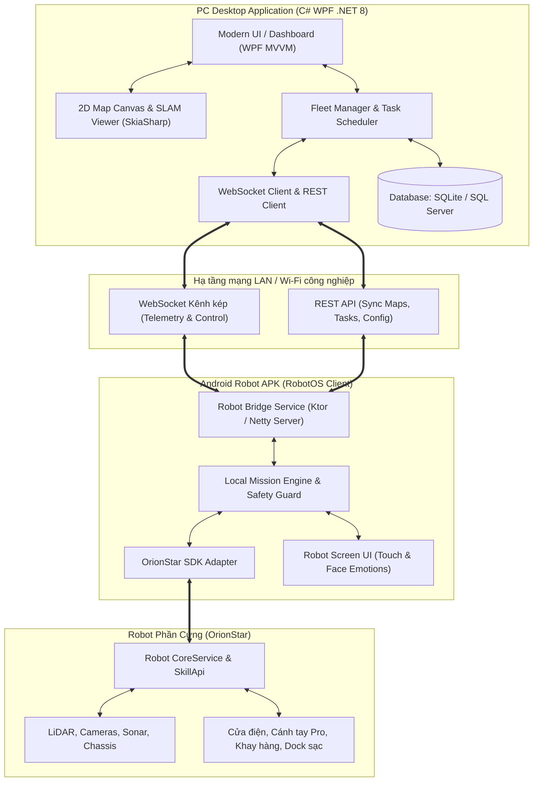
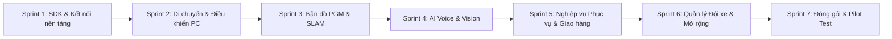

# KẾ HOẠCH PHÁT TRIỂN HỆ THỐNG ĐIỀU KHIỂN ROBOT ORIONSTAR
## LE HOANG ROBOTICS – ORIONSTAR CONTROL CENTER

---

## 1. TỔNG QUAN HỆ THỐNG & ĐỊNH HƯỚNG DỰ ÁN

Hệ thống được thiết kế theo mô hình điều khiển phân tán:
1. **PC Desktop Application (Trung tâm chỉ huy & quản trị)**: Ứng dụng Native Windows (C# .NET 8 WPF, MVVM), giao diện hiện đại mang nhận diện thương hiệu **Lê Hoàng Robotics**, hỗ trợ song ngữ (Tiếng Việt / Tiếng Anh). Chịu trách nhiệm giám sát toàn diện, vẽ bản đồ số trực quan, lập lộ trình nhiệm vụ, điều khiển từ xa thời gian thực và quản lý đa robot (Fleet Management).
2. **Android Robot APK (Trực tháp chấp hành trên Robot)**: Chạy trên nền tảng RobotOS (Android), tương tác trực tiếp với phần cứng robot qua OrionStar SDK (`RobotService.jar`), tích hợp máy chủ giao tiếp nội bộ (Local WebSocket / HTTP Server) để nhận lệnh tức thì từ PC và phát dữ liệu trạng thái (telemetry) ngược về PC.



---

## 2. BẢNG NĂNG LỰC ORIONSTAR SDK & ĐỐI CHIẾU CHỨC NĂNG

Từ việc phân tích mã nguồn mẫu `RobotSample-main` và thư viện lõi `robotservice.jar`, toàn bộ chức năng của robot được phân loại và ánh xạ như sau:

| Nhóm chức năng | Lớp / API OrionStar | Khả năng thực thi | Trạng thái tích hợp |
| :--- | :--- | :--- | :--- |
| **Chuyển động (Motion)** | `RobotApi.goForward()`, `goBackward()`, `turnLeft()`, `turnRight()`, `stopMove()` | Điều khiển tiến, lùi, quay góc, điều chỉnh vận tốc, dừng khẩn cấp | APK + PC Live Control |
| **Xoay đầu (Head Control)** | `RobotApi.moveHead(reqId, "relative", ...)` | Xoay góc ngang/dọc (Yaw, Pitch) của đầu robot | APK + PC Joystick |
| **Bản đồ (Map / SLAM)** | `RobotApi.getMapName()`, `ShareMemoryApi.getMapPgmPFD()` | Lấy danh sách map, xuất file ảnh lưới bản đồ `pgm.zip` | Đồng bộ hiển thị lên PC |
| **Tọa độ & Vị trí** | `RobotApi.getPlaceList()`, `getInternationalPlaceList()`, `setPoseEstimate()` | Quản lý điểm đến (PoseBean), định vị lại vị trí robot | Hiển thị 2D trên PC + APK |
| **Điều hướng (Navigation)** | `RobotApi.startNavigation()`, `stopNavigation()` | Điều hướng tự hành tránh vật cản động đến đích | Lệnh từ PC hoặc Màn hình |
| **Dẫn đường (Leading)** | `RobotApi.startLead(reqId, LeadingParams, listener)` | Dẫn khách theo lộ trình kèm theo dõi người đi sau | Nghiệp vụ tiếp đón khách |
| **Tuần tra (Cruise)** | `RobotApi.startCruise(reqId, route, startPoint, dockingPoints)` | Chạy tuần tra liên tục qua danh sách các điểm trạm | Nghiệp vụ bảo vệ/quảng cáo |
| **Giọng nói (Speech / Audio)** | `SkillApi.playText()`, `SkillApi.queryByText()`, `AudioManager` | Phát âm thanh TTS, nhận dạng giọng nói ASR, ghi âm 16kHz WAV | Tích hợp AI / Chatbot Tiếng Việt |
| **Thị giác (Vision)** | `PersonApi.getAllPersons()`, `PersonUtils.getBestBody()` | Nhận diện người, nhận diện khuôn mặt, bắt mục tiêu | Bám người & Chào đón |
| **Bám người (Body Follow)** | `RobotApi.startBodyFollow()` | Robot tự động đi theo sau hoặc song song với người | Hỗ trợ vận chuyển hành lý |
| **Pin & Dock sạc (Charge)** | `RobotApi.startNaviToAutoChargeAction()`, `leaveChargingPile()`, `disableBattery()` | Tự tìm về dock sạc, thoát trạm sạc, đo pin theo % thực | Tự động hóa 100% |
| **Cửa điện (Electric Door)** | `RobotApi.registerStatusListener(STATUS_CAN_ELECTRIC_DOOR_CTRL)`, `CanElectricDoorBean` | Đóng/mở cửa buồng chứa hàng tự động theo mã khoang | Nghiệp vụ giao hàng bí mật/an toàn |
| **Cánh tay (Robotic Arm)** | `RobotApi.armAction()` *(Chỉ có trên dòng Pro)* | Chạy chuỗi động tác cánh tay theo kịch bản | Chỉ kích hoạt nếu phát hiện model Pro |
| **Tích hợp Thang máy/Cửa** | `Definition.ElevatorAction`, `Definition.RobotElevatorState` | Gửi tín hiệu gọi thang máy, mở cổng tự động qua IoT Bridge | Mở rộng quy mô tòa nhà |

> [!IMPORTANT]
> **Quy tắc vận hành APK trên RobotOS**:
> Khi biên dịch và cài đặt APK lên Robot, **phải khởi động ứng dụng trực tiếp bằng cách chạm vào icon trên màn hình cảm ứng của Robot** trong lần chạy đầu tiên. Khởi động qua lệnh ADB Debug sẽ không kích hoạt handshake token với `CoreService`, dẫn đến toàn bộ API phần cứng bị khóa.

---

## 3. KIẾN TRÚC GIAO TIẾP & DỮ LIỆU (PC ⟷ ROBOT)

### 3.1. Giao thức truyền thông song song (Hybrid Protocol)
- **Kênh Real-time (WebSocket Server trên Robot APK)**: 
  - Robot chủ động push telemetry (tần số 2Hz - 5Hz): Tọa độ `Pose2d (x, y, theta)`, dung lượng pin `battery%`, trạng thái điều hướng (`NAVIGATING`, `ARRIVED`, `OBSTACLE`), cảnh báo lỗi.
  - PC gửi lệnh tức thì (Live Joystick): Tiến, lùi, quay, dừng khẩn (`EMERGENCY_STOP`).
- **Kênh Dịch vụ (RESTful API)**:
  - Đồng bộ dữ liệu dung lượng lớn: Tải file bản đồ `.pgm`, danh sách điểm tọa độ (Place List), cập nhật kịch bản nhiệm vụ.

### 3.2. Cấu trúc thông điệp chuẩn (JSON Command Schema)
```json
{
  "msgId": "cmd_98234812",
  "robotId": "LH-ROBOT-01",
  "command": "NAVIGATE_TO",
  "timestamp": 1731300000,
  "payload": {
    "targetPlace": "Bàn số 12",
    "speed": 0.8,
    "avoidDistance": 0.5,
    "onArrivalAction": {
      "tts": "Xin chào quý khách, món ăn đã được chuyển đến bàn 12.",
      "doorOpen": [1, 2],
      "waitTimeSeconds": 60
    }
  }
}
```

---

## 4. CHI TIẾT CÁC PHÂN HỆ PHẦN MỀM

### 4.1. Ứng dụng PC Desktop (Lê Hoàng Robotics Control Center)
- **Công nghệ nền tảng**: C# WPF (.NET 8), CommunityToolkit.Mvvm, MaterialDesignInXaml, SkiaSharp (Render đồ họa map siêu mượt).
- **Các phân hệ màn hình chính**:
  1. **Dashboard Tổng quan**: Tổng số robot trong hệ thống, trạng thái trực tuyến/ngoại tuyến, biểu đồ mức pin, thống kê nhiệm vụ hoàn thành trong ngày.
  2. **Bản đồ 2D & Điều khiển trực tiếp (Live Map & Teleoperation)**:
     - Render bản đồ số PGM lấy từ robot, hiển thị tâm robot di chuyển thời gian thực theo tọa độ `(X, Y, Theta)`.
     - Cho phép click chuột trực tiếp lên bản đồ để ra lệnh: "Đi tới điểm này", "Đặt điểm đích mới", "Chỉ định vùng cấm".
     - Cụm điều khiển ảo: Bàn phím ảo / Joystick điều khiển chuyển động chassis và xoay cụm camera/đầu. Nút **Dừng khẩn cấp màu đỏ (Emergency Stop)** luôn nổi trên màn hình.
  3. **Quản lý nhiệm vụ (Task Dispatcher)**:
     - Lập lịch nhiệm vụ tự động: Chế độ phục vụ nhà hàng (Giao thức ăn), Chế độ tuần tra (Patrol theo giờ), Chế độ tiếp đón lễ tân.
     - Xếp hàng đợi nhiệm vụ (Task Queue) khi robot đang bận.
  4. **Quản lý đội robot (Fleet Management)**:
     - Phối hợp đa robot hoạt động trên cùng một bản đồ, chống xung đột đường đi (De-conflict routing).
     - Giám sát vị trí của tất cả các robot cùng lúc.
  5. **Cấu hình & Nhật ký sự kiện**:
     - Cấu hình âm lượng, giọng đọc tiếng Việt, điều chỉnh tốc độ an toàn.
     - Lưu trữ log lịch sử hành trình, log lỗi phần cứng xuống CSDL nội bộ.

### 4.2. Ứng dụng Robot APK (Lê Hoàng Robot Service)
- **Công nghệ nền tảng**: Android SDK (Java/Kotlin), MinSDK 16, TargetSDK 29, Thư viện nhúng `robotservice.jar`, nhúng Embedded Ktor/NanoHTTPD Web Server.
- **Các thành phần cốt lõi**:
  1. **Background Service (`RobotBridgeService`)**: Chạy thường trực, quản lý kết nối socket với PC, đón nhận Intent từ hệ thống RobotOS, tự khôi phục kết nối khi mạng chập chờn.
  2. **SDK Hardware Manager**: Đóng gói các hàm gọi `RobotApi`, `SkillApi`, `PersonApi` thành các module độc lập có cơ chế callback xử lý lỗi thông minh.
  3. **Giao diện tương tác người dùng trên Robot**:
     - Màn hình biểu cảm cảm xúc (Face Emotion UI) khi robot ở trạng thái chờ.
     - Màn hình thông báo trạng thái phục vụ: "Đang chuyển hàng tới Bàn...", "Mời quý khách đi theo tôi...".
     - Màn hình thao tác tại chỗ: Cho phép nhân viên nhập mã bàn trực tiếp hoặc nhấn nút xác nhận "Đã lấy món / Hoàn thành".

---

## 5. LỘ TRÌNH TRIỂN KHAI THEO GIAI ĐOẠN (SPRINT ROADMAP)

Dự án được chia thành **7 Sprint thực chiến** với tiêu chí hoàn thiện từng bước vững chắc:



### Sprint 1: Khung kiến trúc & Kết nối nền tảng (Tuần 1 - 2)
- **Mục tiêu**: Xây dựng cấu trúc dự án APK và PC, kết nối thành công với `CoreService` và thiết lập kênh truyền thông hai chiều.
- **Công việc**:
  - Tạo dự án Android Studio chuẩn hóa dựa trên `RobotSample-main`.
  - Khởi tạo Service chạy ngầm, tích hợp `RobotApi.connectServer()` và `SkillApi.connectApi()`.
  - Cài đặt Ktor/WebSocket Server trên Android; xây dựng kết nối WebSocket Client trên WPF PC.
  - Test ping-pong heartbeat và truyền nhận gói tin trạng thái pin, trạng thái kết nối.
- **Tiêu chí nghiệm thu**: PC hiển thị đèn xanh online/offline của Robot và % pin theo thời gian thực.

### Sprint 2: Điều khiển chuyển động & Teleoperation (Tuần 3)
- **Mục tiêu**: PC điều khiển robot di chuyển và xoay đầu mượt mà, phản hồi tức thì dưới 100ms.
- **Công việc**:
  - Tích hợp cụm API chuyển động: `goForward`, `goBackward`, `turnLeft`, `turnRight`, `stopMove`.
  - Tích hợp API xoay đầu: `moveHead`.
  - Xây dựng giao diện Joystick ảo và bắt phím (W, A, S, D) trên PC.
  - Cơ chế an toàn (Safety Watchdog): Tự động dừng xe nếu mất tín hiệu truyền thông quá 500ms.
- **Tiêu chí nghiệm thu**: Robot di chuyển theo lệnh bàn phím/chuột từ PC và dừng ngay lập tức khi thả phím hoặc ấn Stop.

### Sprint 3: Đồng bộ Bản đồ PGM & Điều hướng tự hành (Tuần 4 - 5)
- **Mục tiêu**: PC tải và hiển thị bản đồ gốc của robot; ra lệnh điều hướng điểm thành công.
- **Công việc**:
  - Đọc file PGM qua `ShareMemoryApi.getMapPgmPFD()` từ APK, nén và truyền về PC qua REST API.
  - Xây dựng Canvas hiển thị Map trên PC (chuyển đổi tọa độ pixel PGM sang mét thế giới thực).
  - Lấy danh sách điểm mốc (`getInternationalPlaceList`) và vẽ lên giao diện PC.
  - Tích hợp `startNavigation` và `stopNavigation`; vẽ quỹ đạo robot đang chạy trên PC.
- **Tiêu chí nghiệm thu**: Bấm vào một điểm bàn trên bản đồ PC, robot tự động lập đường đi và di chuyển đến đúng vị trí.

### Sprint 4: Thị giác, Giọng nói & Tương tác thông minh (Tuần 6)
- **Mục tiêu**: Tích hợp âm thanh tiếng Việt, nhận diện người và dẫn đường.
- **Công việc**:
  - Tích hợp TTS phát giọng nói tiếng Việt qua `SkillApi.playText` hoặc engine TTS offline/online tiếng Việt chất lượng cao.
  - Xử lý nhận dạng `PersonApi`: Phát hiện người đứng đối diện, kích hoạt câu chào.
  - Tích hợp module dẫn đường `startLead`: Robot dẫn khách đến bàn và tự kiểm tra khách có đi theo sau không.
- **Tiêu chí nghiệm thu**: Robot tự chào khi phát hiện người và dẫn khách đến điểm chỉ định.

### Sprint 5: Hoàn thiện Nghiệp vụ Phục vụ & Giao hàng (Tuần 7 - 8)
- **Mục tiêu**: Đóng gói quy trình nghiệp vụ nhà hàng/văn phòng hoàn chỉnh.
- **Công việc**:
  - Xây dựng quy trình giao đồ ăn: Chọn bàn -> Mở cửa khoang hàng (nếu có model cửa điện) -> Chạy đến bàn -> Thông báo khách nhận món -> Nhấn xác nhận -> Tự động quay về trạm chờ.
  - Xây dựng quy trình tuần tra: Lập danh sách các chốt kiểm tra (`startCruise`), robot tuần tự đi qua và phát thông báo hoặc quay video.
  - Tự động về sạc: Khi pin < 20%, robot tự ngắt nhận nhiệm vụ và kích hoạt `startNaviToAutoChargeAction`.
- **Tiêu chí nghiệm thu**: Toàn bộ chu trình từ giao hàng đến sạc tự động hoạt động trơn tru không cần can thiệp thủ công.

### Sprint 6: Quản lý Đội xe đa Robot & Phần cứng mở rộng (Tuần 9)
- **Mục tiêu**: Quản lý từ 2 robot trở lên trên cùng phần mềm PC; tích hợp cơ cấu đặc thù.
- **Công việc**:
  - Nâng cấp phần mềm PC hỗ trợ kết nối danh sách nhiều Robot (Fleet List).
  - Điều phối lệnh: Giao nhiệm vụ cho robot gần nhất hoặc robot đang rảnh.
  - Tích hợp module điều khiển Cửa điện (`ElectricDoorControl`) và Cánh tay robot (`ArmControl`) cho các dòng robot cao cấp.
- **Tiêu chí nghiệm thu**: PC quản lý đồng thời 2 robot độc lập, hiển thị song song vị trí 2 robot trên map.

### Sprint 7: Tối ưu, Đóng gói Cài đặt & Thử nghiệm thực địa (Tuần 10 - 11)
- **Mục tiêu**: Đóng gói thành phẩm thương mại mang thương hiệu Lê Hoàng Robotics.
- **Công việc**:
  - Tối ưu hóa UI/UX, thêm logo, phối màu thương hiệu Lê Hoàng Robotics.
  - Đóng gói ứng dụng PC bằng Windows Installer (Inno Setup / MSIX) cài đặt dạng one-click.
  - Đóng gói APK phát hành (Release Keystore) tối ưu dung lượng và bộ nhớ.
  - Viết tài liệu hướng dẫn vận hành, kịch bản xử lý sự cố.
- **Tiêu chí nghiệm thu**: Bộ cài đặt hoàn chỉnh, hoạt động ổn định liên tục trong 48 giờ thử nghiệm thực tế.

---

## 6. QUẢN TRỊ RỦI RO KỸ THUẬT & BIỆN PHÁP DỰ PHÒNG

| Rủi ro kỹ thuật | Mức độ | Biện pháp kỹ thuật phòng ngừa |
| :--- | :---: | :--- |
| **Mất kết nối Wi-Fi giữa PC và Robot** | Cao | Robot phải có cơ chế **Offline Autonomy**: Tự hoàn thành nhiệm vụ dở dang, nếu mất sóng quá lâu tự động tìm đường về trạm sạc hoặc trạm chờ. Khi có sóng lại, tự đồng bộ log về PC. |
| **Xung đột khi thay thế APK gốc** | Trung bình | Xây dựng APK độc lập hoàn toàn, tái hiện lại toàn bộ giao diện bàn ăn và chế độ tiếp đón bằng SDK API cấp thấp (`startNavigation`, `playText`) thay vì phụ thuộc app có sẵn. |
| **Sai lệch tọa độ SLAM khi thay đổi môi trường** | Trung bình | Hỗ trợ tính năng "Relocalize" (Định vị lại) từ xa từ màn hình PC thông qua `RobotApi.setPoseEstimate()`. |
| **Không đồng nhất phần cứng giữa các model** | Thấp | Xây dựng cơ chế **Hardware Feature Detection**: Ứng dụng tự kiểm tra cảm biến/phần cứng khi khởi động; nếu không có cửa điện hay cánh tay, ứng dụng tự ẩn tính năng tương ứng. |
